# GXR A12 50mm（`jlaunch` 1.51）：曲线前 3×3 颜色矩阵（Pre-Curve CCM / Look Matrix）静态逆向报告

## 0. 一句话结论与证据等级

- **结论**：**没有（不存在）**。在 Ricoh GXR A12 50mm（`jlaunch3` 1.51）的硬件 ISP 管线中，**曲线（`Type 23 RLUT` 与 `Type 26 LUT`）之前不存在任何 3×3 颜色矩阵（CCM / Look Matrix）或跨通道线性混合硬件阶段**；甚至连去马赛克（`Type 27 INP` = Interpolation）在硬件管线中都位于 `Type 23 RLUT`、`Type 25 AWBIP`（白平衡增益）和 `Type 26 LUT`（主色调曲线）**之后**，且紧接在唯一 3×3 矩阵模块 `Type 28 MCM`（`0xF034C100`，曲线后 RGB→YCbCr + 色彩校正合一矩阵）**之前**。因此，曲线前无法通过任何寄存器、单元 RAM 或 `T` 参数页注入 3×3 矩阵；`jlaunch3` 镜像内的 DNG `ColorMatrix1/2`（`0x200C5054` / `0x200C509C`）仅属于 `NL1` 出厂标定与 DNG 元数据块（`0x200C4F7C`），从未进入 ISP 硬件管线。
- **证据等级**：**静态确认（Static Confirmed）**。本轮通过固件内置硬件寄存器转储函数 `0x20105678` 及官方硬件模块名表 `0x20129EC8..0x2012A044`，完整解开了 `CamIfSet`（12 个前端 RAW 模块）与 `ISPSet`（8 个后端 ISP 模块）的**理光官方硬件命名、使能位序与寄存器拓扑**，并逐一核对了全部 39 个 `type`（`0..38`）的构建函数、RAM 镜像、写入函数（`0x2029C194` 分发表）与硬件描述符（`0x2029DA8C` 分发表），所有地址均经原始反汇编与固件字节核验。

---

## 1. 核心新发现：固件自曝的官方 ISP 硬件模块命名与真实管线次序

在 `jlaunch3` 第 3 段（`jlaunch3-sec03-load-200f2000.disasm.txt`）的硬件调试转储函数 [`0x20105678..0x20105998`](evidence/01_isp_block_names_and_dump.txt) 中，固件依次遍历两大全局模块描述符指针表：
1. **前端 RAW / 传感器接口管线 `CamIfSet`**：`*(u32*)0x2037FEFC = 0x20383E98`（共 12 个槽位，由 [`0x201130F4..0x201131C0`](evidence/01_isp_block_names_and_dump.txt) 初始化，由 `MidImgProcessor_CamIfSet` `0x2010C3F4` → `0x2010D29C` 构建、`0x2010C474` 提交硬件）。
2. **后端主 ISP 管线 `ISPSet`**：`*(u32*)0x2037FF00 = 0x20383FB8`（共 12 个槽位，其中 8 个非空硬件模块，由 [`0x2011A774..0x2011A86C`](evidence/01_isp_block_names_and_dump.txt) 初始化，由 `MidImgProcessor_ISPSet` [`0x2010BEA4..0x2010C3F0`](evidence/02_isp_pipeline_order_and_awbip.txt) 构建、`0x2010C248` 提交硬件）。

转储函数 `0x20105678` 将每个槽位对应的**理光官方硬件模块缩写字符串**（位于 [`0x20129EC8..0x2012A044`](evidence/01_isp_block_names_and_dump.txt)）连同寄存器镜像一并打印。结合底层驱动 `0x20255600` 的写入函数表 `0x2029C194` 与寄存器描述符表 `0x2029DA8C`，整颗 ISP 的真实硬件结构如下：

### 1.1 前端 RAW 管线（`CamIfSet`，`*0x2037FEFC = 0x20383E98`）

| 槽位 (`P_cam`) | 官方模块名 (`0x20129EC8+`) | Type 编号 | MMIO 寄存器范围 | 单元 RAM 镜像 | 构建/打包函数 | 底层写入函数 (`0x2029C194`) | 静态确认的硬件功能与排除矩阵的依据 |
| --- | --- | --- | --- | --- | --- | --- | --- |
| `+0x00` (`0x20383E98`) | **`CAMREG`** | Type 1 | `0xF0314000..4054` (21 words) | `0x20141594` | `0x2010D39C` | `0x20256988` | 相机接口时序与同步控制寄存器。无像素算术混合。 |
| `+0x04` (`0x20383E9C`) | **`GRYDEC`** | Type 5 | `0xF0316000` (1 word) | `0x20141580` | `0x20112688` | `0x20256988` | 传感器格雷码解码器（Gray Code Decoder），仅 1 个 bit0 使能字。 |
| `+0x08` (`0x20383EA0`) | **`REO`** | Type 6 | `0xF0317000..702C` (9 words) | `0x201415E8` | [`0x20112814`](evidence/03_pre_curve_blocks_reo_dclmp_exip_inp.txt) | `0x20256988` | **Readout / 像素读出通道重排**。按图像高度（`<300, <400, <480, >=480`）查 9 张 4 档表 `0x2012BD54..0x2012BE18`；除 `0x2012BE08` 含常数 `0x0032`（50）写入 `0xF0317028` 外，其余 8 张表**全为 0**。绝非颜色矩阵。 |
| `+0x0C` (`0x20383EA4`) | **`CCDIF`** | Type 7 | `0xF0310000..003C` (8 words) | `0x20141534` | `0x2010CAC4` | `0x20256988` | CCD 传感器读出窗口与接口控制。 |
| `+0x10` (`0x20383EA8`) | **`CDP`** | Type 8 | `0xF0311004, F0312000` (512 words) | `0x2014152C` | `0x2010CC0C` | `0x202569C8` | CCD 坏点校正（CCD Defect Pixel），加载坏点坐标表。 |
| `+0x14` (`0x20383EAC`) | **`DCLMP`** | Type 9 | `0xF0315004..502C` (11 words) | `0x20141554` | [`0x2010CD9C`](evidence/03_pre_curve_blocks_reo_dclmp_exip_inp.txt) | `0x20256988` | 数字暗电流钳位 / 光学黑电平（Digital Clamp）。仅对单通道做黑电平减法/钳位，无跨通道乘加。 |
| `+0x18` (`0x20383EB0`) | **`VK`** | Type 10 | `0xF0319000..9004` (1 word) | `0x201426C8` | `0x201129B4` | `0x20256A50` | 纵向条纹/暗电流校正控制（固定写常数 `16`）。 |
| `+0x1C` (`0x20383EB4`) | **`MCR`** | Type 11 | `0xF0318000, 8004, 8024, 8028` (4 words) | `0x20141584` | [`0x201123EC`](evidence/03_pre_curve_blocks_reo_dclmp_exip_inp.txt) | `0x20256988` | 传感器读出宏块/裁剪窗口坐标（2 个使能 bit + 2 个 12-bit 窗口字）。 |
| `+0x20` (`0x20383EB8`) | **`SMR`** | Type 12 | `0xF031A000` (1 word) | `0x201426C4` | [`0x2011257C`](evidence/03_pre_curve_blocks_reo_dclmp_exip_inp.txt) | `0x20256988` | CCD 高光溢出拖尾校正（Smear Correction，对应日志串 `"ImgProcessor_SetSMRSetting(%d) Error\n"`），仅 1 个 32-bit 控制字。 |
| `+0x24` (`0x20383EBC`) | **`SCR`** | Type 13 | `0xF0320000..00B4, F0321000` (48+1024 words) | `0x2014160C` | `0x20112ABC` | `0x20256B64` | 径向镜头暗角校正（Shading Correction Radial），含光心坐标与 1024 项径向增益 LUT。 |
| `+0x28` (`0x20383EC0`) | **`SCM`** | Type 14 | `0xF0322000..203C, F0324000` (16+1939 words) | `0x201426E4` | `0x20113038` | `0x20256C00` | 四通道二维空间网格暗角/色偏增益校正（Shading Color Map，4×484 空间乘性增益网格）。每个 Bayer 相位独立乘空间增益，无跨通道求和。 |
| `+0x2C` (`0x20383EC4`) | **`AWBCAM`** | Type 15 | `0xF0328008..8028` (6 words) | `0x201426CC` | `0x201129D0` | `0x20256988` | 前端 RAW 域白平衡统计累加器窗口与阈值配置（只读统计，不改主路像素）。 |

此外，位于同一 MMIO 区间的 **Type 16**（`0xF032C000..C140`，写入函数 [`0x20256C9C`](evidence/03_pre_curve_blocks_reo_dclmp_exip_inp.txt)）与 **Type 17**（`0xF032A000..B000`，写入函数 [`0x20256D48`](evidence/03_pre_curve_blocks_reo_dclmp_exip_inp.txt)）分别由驱动 `0x2024C480`（日志串 `"AF_DMA"`，从 `0xF032C140` 读回对焦评估值）与 `0x2024DFE0`（日志串 `"AM_DMA"`，从 `0xF032B000` 读回 32×1536 字节 AE/AWB 测光统计块）管理，均属于纯统计/评估旁路。

---

### 1.2 后端主 ISP 管线（`ISPSet`，`*0x2037FF00 = 0x20383FB8`）

后端主 ISP 管线由顶层控制块 **Type 18 = `ISPREG`**（`0xF0330000..000C`，RAM 镜像 `0x20143684`）统管。在 [`0x2010EE40..0x2010F180`](evidence/02_isp_pipeline_order_and_awbip.txt) 中，固件构建 `ISPREG` 首字（写入 `0xF0330000`）的子模块使能位掩码。**使能位从 bit 7 到 bit 0 的排列次序，与各子模块的 MMIO 物理基址（`0xF0340000` → `0xF0356000`）严格对应**，完整揭示了像素流经后端 ISP 的物理次序：

```mermaid
flowchart LR
    RAW["前端 Bayer RAW\n(DCLMP→SCR→SCM)"] --> WDR["Type 21: WDR\n0xF0340000 (ISPREG bit7=0x80)\n宽动态局部映射"]
    WDR --> RLUT["Type 23: RLUT\n0xF0342000 (ISPREG bit5=0x20)\nRAW 预曲线 (A5/B5 12-bit LUT)"]
    RLUT --> EXIP["Type 24: EXIP\n0xF0343000 (ISPREG bit4=0x10)\n高光折线压缩 (16/17点膝部表)"]
    EXIP --> AWBIP["Type 25: AWBIP\n0xF0348004 (ISPREG bit3=0x08)\n四通道白平衡增益 (初值 512)"]
    AWBIP --> LUT["Type 26: LUT\n0xF0349000 (ISPREG bit2=0x04)\n主色调/对比度曲线 (3×33槽)"]
    LUT --> INP["Type 27: INP (Demosaic)\n0xF034A000 (ISPREG bit1=0x02)\n去马赛克插值與伪色抑制"]
    INP --> MCM["Type 28: MCM\n0xF034C000 (ISPREG bit0=0x01)\nC100 唯一3×3矩阵 + C040/C080 24扇区"]
    MCM --> FLT["Type 32: FLT\n0xF0353000/56000\nYCbCr 降噪与锐化滤波"]
```

| 槽位 (`P_isp`) | 官方模块名 (`0x20129FE8+`) | `ISPREG` (`0xF0330000`) 使能位 | Type 编号 | MMIO 写入地址 (`0x2029DA8C`) / 读回地址 | 单元 RAM 镜像 | 构建/打包函数 | 底层写入函数 (`0x2029C194`) | 静态确认的硬件语义 |
| --- | --- | --- | --- | --- | --- | --- | --- | --- |
| `+0x00` (`0x20383FB8`) | **`ISPREG`** | — | Type 18 | `0xF0330000..000C` (5 words) | `0x20143684` | `0x2011A714` | `0x20256988` | 后端 ISP 顶层子模块使能位掩码与图像尺寸。 |
| `+0x04` (`0x20383FBC`) | **`WDR`** | `bit 7 (0x80)` | Type 21 | `0xF0340000..06DC` (14+264 words) | `0x2014322C` | `0x2011A654` | `0x20256D88` | 宽动态范围 / 空间局部色调映射。 |
| `+0x0C` (`0x20383FC4`) | **`RLUT`** | `bit 5 (0x20)` | Type 23 | 写 `0xF0342000..210C` / 读 `0xF0344000..410C` (68 words) | `0x20143118` | `0x201195A4` | `0x20257334` | RAW 预曲线 LUT（31 个 u16 节点 + 3×33 个 12-bit 输出，源表 `A5` `0x20130290` / `B5` `0x20130404..071C`）。 |
| `+0x10` (`0x20383FC8`) | **`EXIP`** | `bit 4 (0x10)` | Type 24 | 写 `0xF0343000..3080` / 读 `0xF0346000..607C` (28 words) | `0x20142F90` | [`0x2011825C`](evidence/03_pre_curve_blocks_reo_dclmp_exip_inp.txt) | [`0x20257394`](evidence/03_pre_curve_blocks_reo_dclmp_exip_inp.txt) | 曝光/高光折线压缩块（从 `T+0x3092..0x30FF` 读四通道门限与 16/17 点单调折线表，非矩阵）。 |
| `+0x14` (`0x20383FCC`) | **`AWBIP`** | `bit 3 (0x08)` | Type 25 | `0xF0348004, F034800C..8018` (5 words) | `0x20142F7C` | [`0x20118180`](evidence/02_isp_pipeline_order_and_awbip.txt) / [`0x2010EF98`](evidence/02_isp_pipeline_order_and_awbip.txt) | `0x20256988` | 四通道白平衡独立乘性增益（初值 `512` = 1.0）。 |
| `+0x18` (`0x20383FD0`) | **`LUT`** | `bit 2 (0x04)` | Type 26 | 写 `0xF0349000..90AC` / 读 `0xF0352000..20AC` (44 words) | `0x20143004` | `0x20118468` | `0x20257430` | 主色调曲线 / 对比度 Gamma LUT（31×u16 横坐标 + 3×33×u8 输出槽）。 |
| `+0x1C` (`0x20383FD4`) | **`INP`** | `bit 1 (0x02)` | Type 27 | 写 `0xF034A000..B068` / 读 `0xF0354000..5050` (25 words) | `0x201430B4` | [`0x201188B4`](evidence/03_pre_curve_blocks_reo_dclmp_exip_inp.txt) | [`0x20257490`](evidence/03_pre_curve_blocks_reo_dclmp_exip_inp.txt) | **Interpolation（去马赛克 / Demosaic）**。全部寄存器均为方向插值阈值、边缘门限与色差滤波权重，无 3×3 矩阵。 |
| `+0x20` (`0x20383FD8`) | **`MCM`** | `bit 0 (0x01)` | Type 28 | `0xF034C000..C13C` (54 words) | `0x20142AB0` | [`0x20113C7C`](evidence/04_type28_mcm_and_dng_colormatrix.txt) / `0x20114628` | [`0x20257550`](evidence/04_type28_mcm_and_dng_colormatrix.txt) | **Matrix / Color Management**。含 `C040`（24 扇区色相边界）、`C080`（24 扇区多轴色彩修正）、**`C100`（全管线唯一 3×3 矩阵 + 偏置）**、`C120`（色度膝部增益）。 |
| `+0x2C` (`0x20383FE4`) | **`FLT`** | `ISPREG+4` | Type 32 | 写 `0xF0353000..` / 读 `0xF0356000..8098` (252 words) | `0x20142B88` | `0x20116758` | `0x20257690` | YCbCr 域空间降噪与锐化滤波器（Filter）。 |

---

## 2. 六个问题的逐项回答与反汇编铁证

### 问题 1：从 demosaic 到 type 23/26 曲线之间，是否存在一个对 RGB 做 3×3（可带偏置）的硬件阶段？它是哪个 type，寄存器在哪里，写入函数是什么，数值格式（Q 几、符号、范围）如何？

**回答（静态确认）**：
1. **不存在**。而且硬件真实次序与常规印象相反：
   - **去马赛克是 `Type 27 = INP`（Interpolation，`0xF034A000..B068`）**，它在硬件管线中位于 **`Type 23 = RLUT`（`0xF0342000`）与 `Type 26 = LUT`（`0xF0349000`）之后**，而非之前！
   - 在 `Type 23 RLUT` 与 `Type 26 LUT` 之前，像素仍处于 Bayer RAW 四通道域（依次经过前端 `DCLMP` 黑电平 → `SCR` 径向暗角 → `SCM` 二维空间增益 → 后端 `WDR` → `RLUT` 12-bit 曲线 → `EXIP` 高光压缩 → `AWBIP` 四路白平衡增益 → `LUT` 对比度曲线），随后才进入 `Type 27 INP` 完成去马赛克插值得到三通道 RGB，并立即送入 `Type 28 MCM`（`0xF034C000..C13C`）。
2. **全管线唯一的 3×3 硬件矩阵阶段就是 `Type 28 = MCM` 的 `C100` 子块**（位于 `Type 23/26` 曲线与 `Type 27 INP` 去马赛克**之后**）：
   - **Type 编号**：`Type 28`（官方名称 `MCM` = Matrix / Color Management）。
   - **MMIO 寄存器地址**：`0xF034C100..0xF034C11C`（8 个 32-bit 寄存器，描述符位于 `0x2029C6C0`，RAM 镜像位于 `0x20142B48..0x20142B64`，即 `0x20142AB0 + 0x98`）。
   - **底层硬件写入函数**：[`0x20257550`](evidence/04_type28_mcm_and_dng_colormatrix.txt)（由 `0x2029C194[28]` 分发；上层封装为 `0x20113954` → `0x20255600(28, 0x20142AB0)`）。
   - **数值格式**：
     - 9 个矩阵系数（`m00..m22`）：打包在 `0xF034C100..0xF034C110`（前 5 个 32-bit 寄存器的高/低 16 位），打包函数 [`0x20113C7C..0x20113DC8`](evidence/04_type28_mcm_and_dng_colormatrix.txt) 对每个系数做 `and3 rX, rY, #0x7ff`（**有符号 11-bit 二进制补码，Q8 定点格式，`0x0100 = +1.0`，范围 `[-1024, +1023]` 即 `[-4.0, +3.99609375]`**）。
     - 3 个偏置项（`off0..off2`）：位于 `0xF034C114, 0xF034C118, 0xF034C11C`（后 3 个 32-bit 寄存器），打包函数对其做 `and3 rX, rY, #0x1ff`（9-bit 掩码；标准 RGB→YCbCr 基础行 `0x2012D0C0` 中为 `[0, 128, 128]`，即 `Y` 偏置 `0`、`Cb/Cr` 偏置 `+128`）。

---

### 问题 2：矩阵系数从哪里来？源头与重建时机如何？为什么 `jlaunch3` 里有 DNG `ColorMatrix1/2`（`0x200C5054` / `0x200C509C`）？

**回答（静态确认）**：
由于硬件管线在曲线前没有独立 CCM，**曲线后的 `Type 28 (MCM) C100` 矩阵（由 [`0x20114628..0x20114850`](evidence/04_type28_mcm_and_dng_colormatrix.txt) 构建）是全机唯一被合成与加载的 3×3 矩阵**：

1. **`Type 28 C100` 矩阵的系数来源与合成链（[`0x20114628..0x20114850`](evidence/04_type28_mcm_and_dng_colormatrix.txt)）**：
   - **基准源行（单元 RAM）**：每次调用 `0x20114628` 时，先从单元 RAM 源行 **`0x2012D0C0`**（12×s16：`[77, 150, 29, -43, -85, 128, 128, -107, -21, 0, 128, 128]`，即标准 ITU-R BT.601 全范围 RGB→YCbCr 矩阵）拷贝 24 字节到栈帧。
   - **白平衡 / 光源微调增量（`T` 参数页 + 单元 RAM 表）**：
     - 当 `r6`（白平衡/光源模式标志）为 `1` 或 `2` 时，读取 `T+0x0AD8..0x0AE9`（`r6==1`）或 `T+0x0AEA..0x0AFB`（`r6==2`）的 9 个字节（以 `128` 为零点：`val - 128`），叠加到矩阵 9 个系数上；若 `T` 中对应字节为 `0xFF`，则回退读取单元 RAM 增量表 `0x2012CE8C`（9×s16）。
     - 当 `r7`（附加色温/模式修正索引 `1..4`）非零时，再叠加 `0x2012CEA8 + (r7-1)*18` 的 9×s16 增量表。
   - **原生色彩档位（Vividness 鲜艳度）与黑白/褐色模式（B&W / Sepia）选择**：
     - **黑白/单色模式（`r4 == 1`）**：在 `0x20114648..0x201146D4` 中，直接将 `Cb/Cr` 行的 6 个系数（`m10..m22`）全部清零，仅保留 `Y` 行 `[77, 150, 29]`，并根据单色色调索引 `r5` 从 `T+0x0ADC/0ADE` 或 `0x2012CFD4`（8×2×s16）写入常数 `Cb/Cr` 偏置（实现 B&W 冷暖调或 Sepia 褐色）。
     - **彩色模式（`r4 != 1`）**：在 `0x201147E4..0x20114834` 中，根据鲜艳度档位 `r5`（`0` 对应 `T+0x0ADA` 缩放因子，`1..16` 查表 `0x2012CFE4` 16×u8 缩放因子，基准为 `0x40 = 64`），对 `Cb` 行（`m10, m11, m12`）与 `Cr` 行（`m20, m21, m22`）乘以 `scale / 64`（算术右移 6 位 `srai #6`）。
   - **重建时机**：每次构建 ISP 配置（`MidImgProcessor_ISPSet` `0x2010BEA4` → `0x2010C1E0` → `0x20114AB8` → `0x20114628` → `0x20113C7C`）时**实时重算并重读 `0x2012D0C0`**（包括每次拍摄静态照片、每次切换图像设定/色彩模式以及实时取景更新）。

2. **追通 `jlaunch3` 中 DNG `ColorMatrix1/2`（`0x200C5054` / `0x200C509C`）的真实消费者（[`04_type28_mcm_and_dng_colormatrix.txt`](evidence/04_type28_mcm_and_dng_colormatrix.txt)）**：
   - `0x200C5054` 与 `0x200C509C` 位于 `jlaunch3` 第 1 段只读/初始化数据区的 **2048 字节出厂校准与镜头描述符块 `NL1`（起始地址 `0x200C4F7C`）** 内部：
     - `0x200C4F7C + 0x000`：魔数 `"NL1\0"`。
     - `0x200C4F7C + 0x0D8`（`+216`，即 **`0x200C5054`**）：72 字节（9 个大端 SRATIONAL，分母均为 `0x00002710 = 10000`），即 DNG `ColorMatrix1`。
     - `0x200C4F7C + 0x120`（`+288`，即 **`0x200C509C`**）：72 字节（9 个大端 SRATIONAL，分母均为 `0x00002710 = 10000`），即 DNG `ColorMatrix2`。
     - `0x200C4F7C + 0x17C`（`+380`，即 `0x200C50F8`）：型号字符串 `"RICOH GR LENS A12 50mm F2.5 MACRO\0"`。
   - **唯一访问入口**：函数 [`0x20052FA8`](evidence/04_type28_mcm_and_dng_colormatrix.txt)（当 `r4 == 1` 时返回 flash 加载的 RAM 副本 `0x2029F30C`，当 `r4 == 0` 时返回内置默认块 `0x200C4F7C`）。
   - **消费者去向**：
     1. 机身通信回调 [`0x20052938`](evidence/04_type28_mcm_and_dng_colormatrix.txt)（在 `0x20052CB0` 注册为通道 `13`）调用 `0x20052FA8(1)` 将该 2048 字节块传给机身固件（`ilaunch3`），用于生成 DNG 文件头中的 TIFF 标签 `0xC621`（`ColorMatrix1`）和 `0xC622`（`ColorMatrix2`）。
     2. `jlaunch3` 第 4 段内残留的两处未被引用的 DNG IFD 构建函数 [`0x20160BE8..0x20160CE0`](evidence/04_type28_mcm_and_dng_colormatrix.txt) 与 [`0x201636F0..0x20163750`](evidence/04_type28_mcm_and_dng_colormatrix.txt) 也仅将其作为 72 字节 `memcpy`（`0x2005199C`）数据源写入 TIFF 标签 `0xC621` / `0xC622`。
     3. **没有任何 ISP 构建函数或像素处理代码读取过 `+0x0D8`（`0x200C5054`）或 `+0x120`（`0x200C509C`）**。它们纯粹是供 Adobe Camera Raw / Lightroom 解码 DNG RAW 使用的静态元数据。

---

### 问题 3：白平衡增益（`Type 25 AWBIP` 四路增益）与这个矩阵是同一阶段还是分开的？两者的先后次序如何？

**回答（静态确认）**：
1. **完全分开的两个独立硬件阶段**。
2. **精确硬件细节与次序**：
   - **白平衡增益是 `Type 25 = AWBIP`**（MMIO 寄存器 `0xF0348004` 控制字 + `0xF034800C, 0xF0348010, 0xF0348014, 0xF0348018` 四个通道增益寄存器；RAM 镜像 `0x20142F7C` 初值为 `[0, 512, 512, 512, 512]`，即 Q9 定点 `512 = 1.0`；备份缓冲区 `0x201405E8..0x201405F8`）。
   - 在 [`0x2010EF98..0x2010F050`](evidence/02_isp_pipeline_order_and_awbip.txt) 中，`MidImgProcessor_ISPSet` 将每次拍摄请求结构 `*(Q + 8) + 0x14` 中的 5 个字（控制字 + 四路白平衡增益）拷入 `0x20142F7C..0x20142F8C`，并置位 `ISPREG` 的 `bit 3 (0x08)`，随后在 `0x2010C2A0` 调用 `0x20118168` → `0x20256988` 写入 `0xF0348004..0xF0348018`。
   - **先后次序**：
     - **`Type 25 (AWBIP)` 位于曲线 `Type 26 (LUT)` 与去马赛克 `Type 27 (INP)` 之前**（且在 `Type 23 RLUT` 之后）：`RLUT (Type 23, 0xF0342000)` → `EXIP (Type 24, 0xF0343000)` → **`AWBIP (Type 25, 0xF0348004)`** → `LUT (Type 26, 0xF0349000)` → `INP (Type 27, 0xF034A000)` → **`MCM (Type 28, 0xF034C100, 3×3 矩阵)`**。
     - `Type 25 (AWBIP)` 只有 4 个独立的对角线通道乘数（无非对角线项），而 `Type 28 (MCM)` 的 3×3 矩阵远在 `LUT` 曲线和 `INP` 去马赛克之后。

---

### 问题 4：曲线之前有没有其他跨通道阶段（例如 `type 6/7/9/11/12/15/17/24` 中的某个）？

**回答（静态确认）**：
**没有任何跨通道像素混合阶段**。我们对曲线（`Type 23 RLUT` / `Type 26 LUT`）之前的每一个硬件模块进行了逐一逆向与排除（详见 [`03_pre_curve_blocks_reo_dclmp_exip_inp.txt`](evidence/03_pre_curve_blocks_reo_dclmp_exip_inp.txt)）：

1. **`Type 6 = REO`（`0xF0317000..702C`，9 个寄存器）**：
   - 上一轮因“9 个寄存器”被怀疑是否可能为 3×3 矩阵。本轮通过官方模块名确认为 **`REO`（Readout 读出重排）**，且其打包函数 [`0x20112814..0x2011292C`](evidence/03_pre_curve_blocks_reo_dclmp_exip_inp.txt) 将多个 1-bit/2-bit/12-bit 字段拼入 `0x201415E8..0x20141608`，其数据源表 `0x2012BD54..0x2012BE18` 中前 7 张表与第 9 张表**全部字节为 `0x00`**，仅第 8 张表 `0x2012BE08` 为常数 `0x0032`（50，写入 `0xF0317028`）。彻底排除跨通道矩阵可能。
2. **`Type 7 = CCDIF`（`0xF0310000..003C`）、`Type 9 = DCLMP`（`0xF0315004..502C`）、`Type 11 = MCR`（`0xF0318000..8028`）、`Type 12 = SMR`（`0xF031A000`）**：
   - 分别为 CCD 接口控制、数字暗电流黑电平钳位、传感器窗口裁剪、CCD 垂直拖尾（Smear）消除控制。全部在 Bayer RAW 单像素/单相位上操作，无跨通道运算。
3. **`Type 13 = SCR`（`0xF0320000`）与 `Type 14 = SCM`（`0xF0322000`）**：
   - 径向暗角校正与四通道二维空间增益网格（4×484）。虽然 `SCM` 对 4 个 Bayer 通道分别提供空间乘性增益，但属于纯对角线空间乘法（与镜头位置 `(x, y)` 相关），不能实现 R/G/B 跨通道加减混合。
4. **`Type 15 = AWBCAM`（`0xF0328008`）、`Type 16 = AF_DMA`（`0xF032C000`）、`Type 17 = AM_DMA`（`0xF032A000`）**：
   - 全部是统计/评估累加器与 DMA 输出通道（AWB 统计、AF 对焦对比度 DMA、AE/AWB 分块测光 DMA），不修改主通路像素。
5. **`Type 24 = EXIP`（`0xF0343000..3080`，28 个寄存器）**：
   - 此前看到其末尾有两个循环写入 `0xF0343040`（8 个 word）与 `0xF0343060`（9 个 word），本轮彻底查清其构建函数 [`0x2011825C..0x20118388`](evidence/03_pre_curve_blocks_reo_dclmp_exip_inp.txt) 与 `T+0x3090..0x3100` 默认数据（位于 `0x200B81D4 + 0x3090` 及 `jlaunch8` `V3090..V30BA`）：
     - `T+0x3094..0x309B`：`0x0FC0, 0x088B, 0x08D8, 0x0FC0`（4032, 2187, 2264, 4032），为四通道高光阈值。
     - `T+0x30BC..0x30DB`（8 words = 16×u16，写入 `0xF0343040..305C`）：`[0x0000, 0x0400, 0x0680, 0x0900, 0x0C60, 0x0FFF, 0x1980, 0x3FFF, 0x3FFF × 8]`，为 16 点单调递增输入折线横坐标（14-bit 范围 `0..16383`）。
     - `T+0x30DC..0x30FF`（9 words = 17×u16，写入 `0xF0343060..3080`）：`[0x0000, 0x0400, 0x0680, 0x0900, 0x0C60, 0x0D80, 0x0FFF × 11, 0x0000]`，为对应的 17 点单调递增输出折线纵坐标（将 `[0..0x3FFF]` 压缩至 12-bit `[0..0x0FFF]`）。
     - 因此 `Type 24 (EXIP)` 是高光折线压缩器（且常规模式下 `T+0x3092 = 0` 被旁路），绝非 3×3 颜色矩阵。

---

### 问题 5 & 6：既然曲线前不存在 3×3 颜色矩阵，排除的证据链与对产品色彩拟合的架构结论是什么？剩余未知有哪些？

#### 2.5.1 排除曲线前 3×3 矩阵的完整证据闭环

1. **硬件模块表闭环**：`CamIfSet`（`0x20383E98`）与 `ISPSet`（`0x20383FB8`）完整覆盖了 `0xF0310000..0xF0358098` 的全部图像处理硬件模块，并由 `0x20105678` 给出官方名称。
2. **管线物理顺序闭环**：`ISPREG`（`0xF0330000`）使能位 `0x80 (WDR) → 0x20 (RLUT) → 0x10 (EXIP) → 0x08 (AWBIP) → 0x04 (LUT) → 0x02 (INP/Demosaic) → 0x01 (MCM)` 证实去马赛克 `INP` 在 `RLUT`/`LUT` 曲线之后，在去马赛克之前像素仍是 Bayer RAW，物理上不可能存在 RGB 3×3 矩阵；而在去马赛克 `INP` 与曲线后 `MCM` 之间没有任何其他硬件模块（MMIO 地址从 `INP` 的 `0xF034B068` 直接跳到 `MCM` 的 `0xF034C000`，`ISPREG` 使能位从 `bit 1` 直接到 `bit 0`）。
3. **与 GR III 架构差异的根本原因**：
   - GR III 的 ISP 属于更新一代管线（Bayer → Demosaic → Pre-Curve 3×3 CCM / Look Matrix → Tone Curve → Post-Curve R2Y），因此可以在曲线前改变 RGB 混合比例，再经非线性 S 曲线产生通道间饱和度/色相与亮度的非线性耦合。
   - GXR A12 50mm 的 ISP 属于更早期的 **“RAW/曲线在前、去马赛克与唯一矩阵在后”** 架构（`RLUT` → `AWBIP` → `LUT` → `INP (Demosaic)` → `MCM (3×3 C100 + 24扇区 C080)`）。因此，在 GXR 硬件上，那约 `1.1 ΔE00`（01 正片）与 `1.6–1.7 ΔE00`（02 负片）的“曲线前矩阵 vs 曲线后矩阵”不可交换性误差（non-commutativity loss），是由 **ASIC 硬件管线拓扑（`LUT` 在 `INP` 与 `MCM` 之前）** 决定的物理硬上限，无法通过挖掘隐藏寄存器消除。
   - 在现有硬件拓扑下，唯一位于 `Type 26 LUT` 之前的可编程色彩相关自由度是：
     1. **`Type 25 AWBIP`（`0xF034800C..8018`）**：曲线前的四路乘性白平衡增益（仅对角线缩放，无跨通道非对角项）。
     2. **`Type 23 RLUT`（`0xF0342000`）与 `Type 26 LUT`（`0xF0349000`）的分通道曲线（`C/D` 通道偏移 `0x2013024E`）**：只能在单通道维度改变非线性斜率，随后再由曲线后的 **`Type 28 MCM`（`C100` 3×3 矩阵 `0x2012D0C0` + `C080` 24 扇区多轴修正 `0x2012C5D4` + `C040` 24 扇区色相边界 `0x2012C598`）** 在非线性曲线之后做最佳逼近。

#### 2.5.2 剩余未知（Remaining Unknowns）

1. **`Type 24 (EXIP)` 在特殊模式下的硬件行为**：虽然静态确认 `Type 24` 是单通道/四通道高光折线压缩器（`0xF0343000..3080`）而非 3×3 矩阵，且常规拍摄时 `T+0x3092 = 0` 默认旁路，但其在 `ISPREG` `bit 4 (0x10)` 强制开启时对高光区域的具体硬件插值精度未经实机验证（对色彩矩阵问题无影响）。
2. **`Type 28 (MCM)` 内部子块的硬件串联次序**：在 `Type 28`（`0xF034C000..C13C`）内部，`C100`（3×3 RGB→YCbCr 矩阵）、`C040/C080`（24 扇区多轴色相/饱和度修正）与 `C120`（7 阈值 + 9 增益色度膝部表）同属 `MCM` 模块（共享 `ISPREG` `bit 0` 使能），但三者均位于 `Type 23/26` 曲线之后。

---

## 3. 证据文件索引

本目录 `evidence/` 下包含全部经过反汇编与固件原文字节核对的证据窗口：
- [`evidence/01_isp_block_names_and_dump.txt`](evidence/01_isp_block_names_and_dump.txt)：硬件寄存器转储函数 `0x20105678..0x20105998`、官方硬件模块名字符串表 `0x20129EC8..0x2012A044`、`CamIfSet`（`0x20383E98`）与 `ISPSet`（`0x20383FB8`）初始化函数，以及全部 39 个 Type 的写入函数表（`0x2029C194`）和描述符表（`0x2029DA8C`）。
- [`evidence/02_isp_pipeline_order_and_awbip.txt`](evidence/02_isp_pipeline_order_and_awbip.txt)：`MidImgProcessor_ISPSet`（`0x2010BEA4..0x2010C3F0`）、`ISPREG` 使能位掩码构建与 `Type 25 AWBIP` 每拍白平衡增益装填（`0x2010EE40..0x2010F080`）、`AWBIP` 镜像与写入封装（`0x201180E4..0x20118190`）。
- [`evidence/03_pre_curve_blocks_reo_dclmp_exip_inp.txt`](evidence/03_pre_curve_blocks_reo_dclmp_exip_inp.txt)：曲线前及去马赛克各未知/可疑模块的完整反汇编与数据表转储，涵盖 `Type 6 (REO)`、`Type 9 (DCLMP)`、`Type 11 (MCR)`、`Type 12 (SMR)`、`Type 16 (AF_DMA)`、`Type 17 (AM_DMA)`、`Type 24 (EXIP)`（含 `T+0x3090..0x3110` 折线表）以及 `Type 27 (INP / Demosaic)`。
- [`evidence/04_type28_mcm_and_dng_colormatrix.txt`](evidence/04_type28_mcm_and_dng_colormatrix.txt)：`Type 28 (MCM)` 底层写入函数 `0x20257550`、`C100` 3×3 矩阵合成与打包函数 `0x20113C7C..0x20114850`、`NL1` 出厂标定块 `0x200C4F7C..0x200C51A4`（含 DNG `ColorMatrix1/2` 原样字节）、访问函数 `0x20052FA8` 及 DNG 标签 `0xC621`/`0xC622` 消费链。
